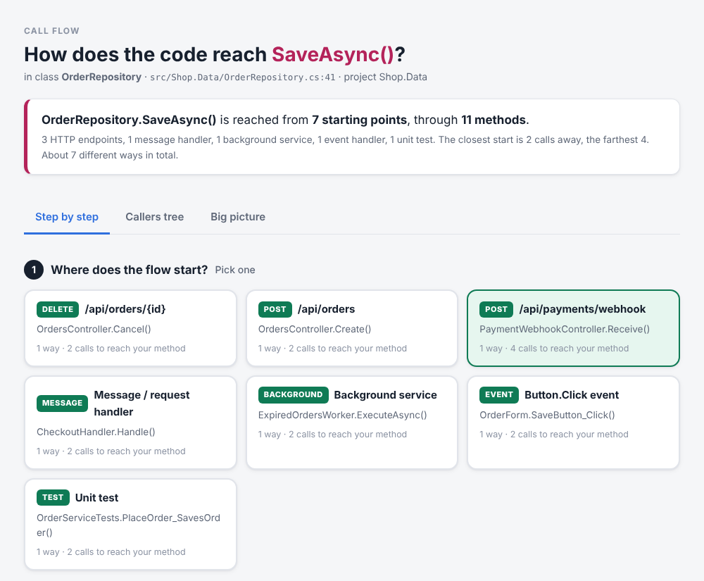
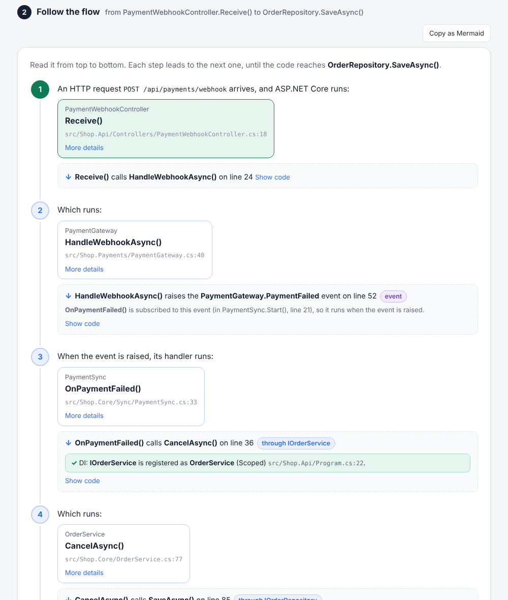
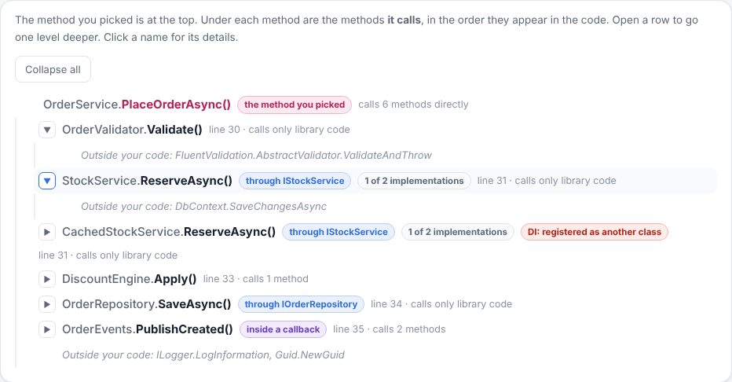
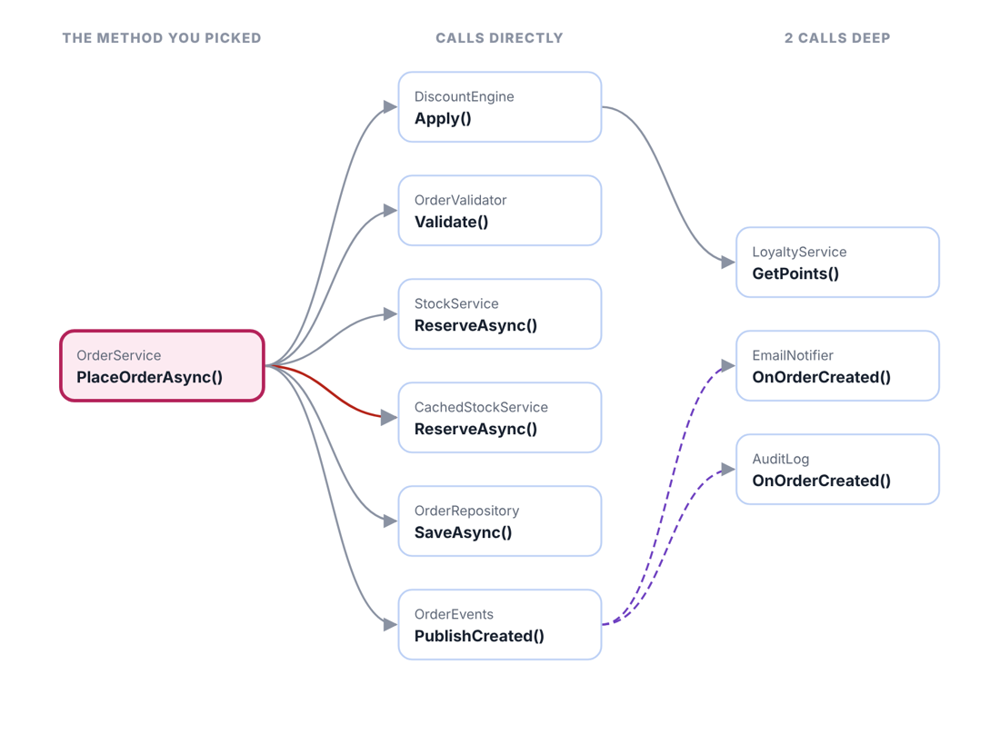
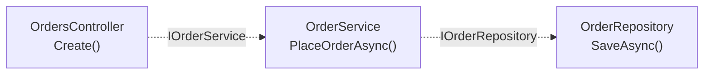

# CallFlowViewer

[](https://www.nuget.org/packages/CallFlowViewer)
[](https://github.com/AhmadNedal/CallFlowViewer/blob/main/LICENSE)

**See how your code gets to a method, and what happens after it, in one click from Visual Studio.**

Put the cursor on any C# method, press **Ctrl+.** and pick one of two actions:

| Action | Answers the question |
|---|---|
| **Show call flow to this method** | *"Who calls this? From which endpoint, job or test does the flow start?"* |
| **Show what this method calls** | *"What happens when this runs? What does it touch on the way?"* |

A page opens in your browser that explains the flow step by step, in plain English, with a diagram.



---

## Install

Add the package to any project in your solution:

```bash
dotnet add package CallFlowViewer
```

Or in Visual Studio: right-click the project > **Manage NuGet Packages** > search for **CallFlowViewer**.

Then **close and reopen Visual Studio** once, so it loads the new actions.

> The package only adds actions to the editor. It is a development dependency: nothing is
> added to your build output and it never ships with your application.

**Requirements:** Visual Studio 2022 version 17.8 or later.

---

## How to use it

1. Open a C# file and put the cursor on the **name of a method**, either where it is declared
   (`public Task SaveAsync(Order order)`) or where it is called (`_orders.SaveAsync(order)`).
2. Press **Ctrl+.** (or right-click > **Quick Actions and Refactorings...**).
3. Choose **Show call flow to this method** or **Show what this method calls**.

The report opens in your default browser. It is a single HTML file that works offline,
so you can also send it to a colleague.

---

## What you get

### Step by step

Pick where the flow starts, then read it from top to bottom. Each step says, in a sentence,
what calls what and on which line. **Show code** reveals the exact lines, **More details**
shows the full method.



When there are hundreds of starting points, they become a searchable list grouped by kind
(HTTP endpoints, message handlers, background services, unit tests...), with unit tests hidden
by default.

### Calls tree

For **Show what this method calls**: every method it calls, in the order they appear in the code.
Open a row to go one level deeper. Calls to libraries (EF Core, `ILogger`, `HttpClient`...)
are listed in grey, so you can see where the code touches the database or the network.



### Big picture

The whole flow as a diagram, read from left to right. Click a box to keep only the flows
that go through it, double-click it to see its code. On large systems, methods are grouped
by class and you choose how many levels to show.



### Put it in a pull request

**Copy Mermaid** copies the diagram (or one path) as a Mermaid block. Paste it into a pull request,
a GitHub / Azure DevOps wiki or any markdown file and it shows up as a diagram:

````markdown

````

You can also download the diagram as **PNG** or **SVG**.

---

## What it understands

| In your code | In the report |
|---|---|
| Calls through an interface (`IOrderService`) | Followed to the implementation, marked *through IOrderService* |
| Calls through a base class / `override` | Followed, marked *through base* |
| Calls inside a lambda (`Task.Run(() => Work())`) | Followed, marked *inside a callback* |
| A method passed as a delegate (`Task.Run(Work)`, `list.ForEach(Process)`) | Followed, marked *delegate* |
| Event handlers (`button.Click += OnClick`) | Followed back to the code that raises the event |
| HTTP endpoints, MediatR handlers, hosted services, middleware, SignalR hubs, Azure Functions, tests, `Main` | Shown as the place where the flow starts, with the route for endpoints (`POST /api/orders`) |
| `nameof(Work)`, `<see cref="Work"/>`, `-= OnClick` | Ignored: they never run the method |
| Recursion | Detected, shown as a loop |

### Dependency injection check

When a step goes through an interface, the report checks your `AddScoped` / `AddTransient` /
`AddSingleton` registrations and tells you which class is really used at runtime:

- **&#10003; registered**: `IOrderService` is registered as `OrderService`, in `Program.cs` line 22.
- **&#9888; registered as another class**: the call most likely goes to a different class, so this step may never happen.
- **created by a factory**: the class can't be read from the code.
- **not registered**: no registration was found.

Registrations in test projects are ignored. If your solution uses another container
(Autofac...), the check is skipped.

---

## Settings

Optional. Add any of these to the `.editorconfig` file of your solution, under `[*.cs]`.
They are read every time you open a report: no rebuild needed.

```ini
[*.cs]
# Look further (defaults: 400 methods, 25 levels)
callflow.max_methods = 1000
callflow.max_depth = 40

# Leave test projects out (faster on big solutions)
callflow.exclude_tests = true

# Leave projects or namespaces out. "*" is a wildcard; a namespace also covers its children.
callflow.exclude_projects = Legacy.*, Tools
callflow.exclude_namespaces = MyApp.Migrations, *.Generated
```

The report shows which settings were used and what was left out.

---

## Good to know

- **It reads your source code, it does not run it.** Calls made through reflection, `dynamic`,
  or framework conventions that are not written in code (for example a method found by name
  at runtime) can't be seen.
- **Big solutions:** the analysis stops at 400 methods / 25 levels by default and says so in the
  report. Raise the limits in `.editorconfig` if you need more.
- **Reports** are saved in `%TEMP%\CallFlowViewer`. Reports older than a week are deleted
  automatically, and only the 30 most recent are kept.

### The action does not show up

- Close and reopen Visual Studio after installing or updating the package.
- Put the cursor on the method **name**, not on an empty line or inside the method body.
- Make sure the project you are in references the package (or another project in the same solution does).
- Check your version: **Help > About Microsoft Visual Studio** must say 17.8 or later.

---

## Contributing

Ideas, bugs and pull requests are welcome. Open an issue on GitHub, or get in touch at
[ahmadnedal.me](https://ahmadnedal.me).

```bash
# Build the package
dotnet pack src/CallFlowViewer/CallFlowViewer.csproj -c Release -o ./nupkg

# Run the tests (or Test > Run All Tests in Visual Studio)
dotnet test
```

The tests in `tests/CallFlowViewer.Tests` build small C# solutions in memory and check the
flows found in them: direct calls, interfaces, delegates, events, recursion, limits,
settings, the DI check and the report itself.

To try your changes inside Visual Studio, reference the project as an analyzer from a project
in the same solution, then restart Visual Studio (it caches analyzer DLLs):

```xml
<ProjectReference Include="..\CallFlowViewer\CallFlowViewer.csproj"
                  OutputItemType="Analyzer" ReferenceOutputAssembly="false" />
```

## License

[MIT](https://github.com/AhmadNedal/CallFlowViewer/blob/main/LICENSE), made by Ahmad Nedal.
